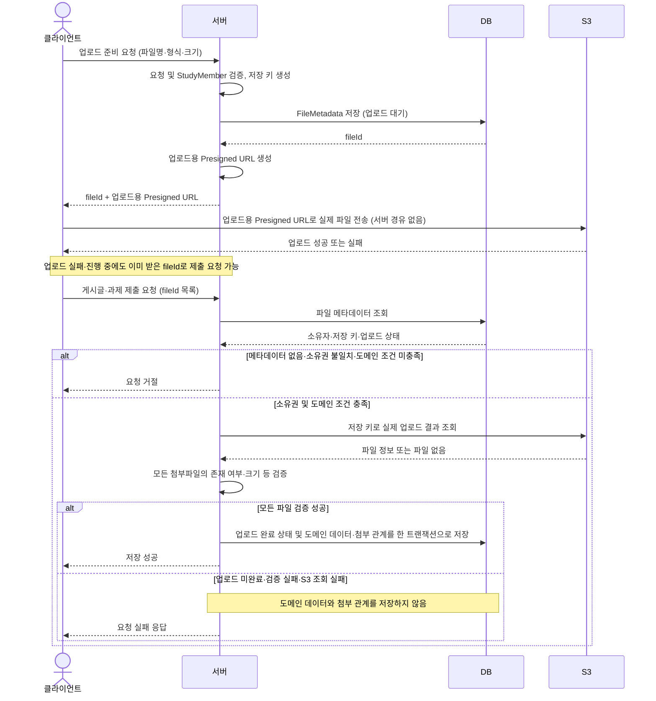

# 0045. 첨부파일 업로드에 S3 Presigned URL을 사용한다

- 날짜: 2026-09-11
- 관련 이슈: [#295](https://github.com/woowacourse-teams/2026-ChongChong/issues/295)

## 배경

총총은 공지와 과제·제출물에 이미지와 파일을 첨부할 수 있도록 공통 업로드 기반을 도입한다.
특히 과제 제출은 여러 스터디가 23시 59분처럼 같은 시간에 마감을 정하고, 각 스터디의 여러 사용자가
마감 직전에 제출하는 사용 패턴을 예상한다. 한 스터디의 평균 사용량보다 여러 스터디의 동시 제출 부하가 중요하다.

현재 논의한 과제 이미지 제한은 한 장당 최대 5MB, 제출당 최대 5장으로, 한 사람이 최대 25MB를 전송할 수 있다.
예를 들어 100명이 최대 용량으로 제출하면 파일 총량은 2.5GB다. 서버 경유 방식에서는 애플리케이션 서버가
이 데이터를 수신하고 S3로 다시 전송해야 한다. 이 수치는 부하 규모를 설명하기 위한 예시이며, 실제 동시 사용자 수나
서버 처리 한계를 측정한 결과는 아니다.

## 결정

첨부파일은 서버가 발급한 S3 Presigned URL을 사용하여 클라이언트에서 S3로 직접 업로드한다.
애플리케이션 서버는 파일 전송 대신 업로드 권한 확인, 업로드용 Presigned URL 발급, 파일 메타데이터 관리와 도메인 연결을 담당한다.

기본 흐름은 다음과 같다. 별도 업로드 완료 확인 API는 두지 않고, 게시글·과제 제출 처리에서 실제 업로드 결과를 검증한다.

1. 클라이언트가 서버에 업로드 준비를 요청한다.
2. 서버가 업로드 권한을 확인하고 저장 위치를 정한 뒤, 파일 식별자와 유효기간이 있는 업로드용 Presigned URL을 반환한다.
3. 클라이언트가 해당 Presigned URL로 실제 파일을 S3에 직접 전송한다. 파일 데이터는 애플리케이션 서버를 거치지 않는다.
4. 클라이언트가 게시글 또는 과제 제출 요청에 파일 식별자를 포함한다.
5. 서버가 파일 소유권과 실제 업로드 상태 등 필요한 검증을 거쳐 도메인과 연결한다.

업로드용 Presigned URL은 임시 업로드 권한이므로 게시글의 영구 파일 주소로 저장하지 않는다.
업로드용 Presigned URL 발급이나 S3 업로드 성공을 과제 제출 완료로 간주하지 않으며, 제출 마감 판정은 별도로 정의한다.

### 파일 메타데이터 저장과 첨부 검증 흐름

`FileMetadata`는 실제 파일 본문이 아니라 소유자와 S3 저장 키 등 파일 관리 정보를 담는 엔티티다.
업로드용 Presigned URL 발급 API에서 요청과 스터디 멤버를 검증한 뒤, 응답 전에 업로드 대기 상태로 DB에 저장한다.
소유자는 업로드를 요청한 `StudyMember`로 관리하며, 원본 파일명·형식·크기 등 클라이언트가 전달한 정보는
실제 업로드 결과를 확인하기 전까지 검증된 정보로 취급하지 않는다.

`fileId`는 업로드 전에 발급되므로 식별자가 존재한다는 사실만으로 S3 업로드 성공을 보장하지 않는다.
업로드가 실패하거나 진행 중이어도 클라이언트가 해당 식별자를 보낼 수 있으므로, 서버는 최종 저장 시
요청자의 스터디 멤버가 파일 소유자인지와 실제 업로드가 검증되었는지를 반드시 확인한다.
첨부 목록 중 하나라도 검증에 실패하면 일부 파일만 연결하여 제출을 완료하지 않는다.
클라이언트의 제출 버튼 비활성화나 업로드 성공 보고는 서버 검증을 대신하지 않는다.

업로드 완료 확인은 최종 게시글·과제 제출 처리에 포함한다. 서버는 소유권을 확인한 파일의 저장 키로 S3 업로드 결과를
조회하고 검증한다. 모든 첨부파일 검증에 성공하면 업로드 완료 상태 반영과 도메인 데이터·첨부 관계 저장을
하나의 DB 트랜잭션으로 처리한다. S3 조회에 실패해 업로드 결과를 확인할 수 없는 경우에도 제출을 완료 처리하지 않는다.
공지·과제·제출물의 첨부 테이블은 각 도메인 식별자와 `fileId`를 연결한다.
업로드하지 않거나 작성 중 취소한 경우 남는 대기 메타데이터와 연결되지 않은 S3 파일은 추후 정리 대상으로 관리한다.

## 선택 이유

마감 직전에 여러 스터디의 파일 전송이 집중되어도 애플리케이션 서버가 파일 본문을 수신하고 재전송하지 않도록 한다.
이를 통해 대용량 전송으로 인한 서버 네트워크와 요청 처리 자원 부담을 줄이고, 인증·과제 제출·조회 같은
애플리케이션 요청에 미치는 영향을 줄인다.

이미지 선택 후 업로드와 최종 제출 요청을 분리할 수 있으며, 최종 제출에는 답변과 파일 식별자만 전달할 수 있다.
이 분리는 서버 경유 방식에서도 가능하지만, Presigned URL은 파일 전송 경로 자체를 서버 밖으로 옮긴다는 차이가 있다.

이 결정은 특정 동시 사용자 수에서 서버 경유 방식이 실패한다는 측정에 근거하지 않는다.
마감 시간이 겹치는 서비스 특성을 고려해 파일 전송 부하를 분리하는 선택이며, 업로드용 Presigned URL 발급·DB 처리·제출 검증에 대한
부하 검증은 여전히 필요하다.

## 검토한 대안

### 애플리케이션 서버를 경유하여 S3에 업로드한다

서버가 파일을 받아 검증하고 S3로 전송하므로 클라이언트 요청 흐름이 단순하며, 실제 파일 내용을 서버에서 검사하기 쉽다.
그러나 마감 직전 동시 제출 시 파일 수신과 S3 전송이 서버에 집중된다. 스트리밍으로 메모리 부담을 줄이더라도
서버를 통과하는 전송량은 남으므로 현재 예상하는 사용 패턴에서는 선택하지 않는다.

## 영향

### 긍정적 영향

- 동시 업로드 시 애플리케이션 서버가 처리하는 파일 전송량을 줄인다.
- 파일 업로드와 과제 제출 요청을 분리하여 각각의 상태와 실패를 처리할 수 있다.
- 공지와 과제·제출물 첨부에서 공통 업로드 흐름을 사용할 수 있다.

### 부정적 영향과 위험

- 클라이언트가 업로드용 Presigned URL 발급, S3 업로드, 최종 제출을 나누어 처리하고 실패·재시도 상태를 관리해야 한다.
- 클라이언트가 보고한 업로드 성공이나 파일 메타데이터만 신뢰할 수 없으므로 실제 업로드 결과 검증이 필요하다.
- 최종 제출 처리에 S3 조회가 포함되므로 S3 응답 지연·장애가 제출 응답 시간과 성공 여부에 영향을 준다.
- 업로드 후 제출을 취소하거나 마감이 지나면 연결되지 않은 파일이 남아 정리 정책이 필요하다.
- Presigned URL의 유효기간과 허용 작업을 제한하고, 비공개 제출물의 파일 조회 권한을 별도로 보호해야 한다.
- 사용자 네트워크에 따른 업로드 지연과 최종 제출 API의 동시 요청 부하는 남는다. 마감 내 제출을 보장하는 수단은 아니다.

## 미확정 사항

- Presigned PUT 또는 POST 방식, Presigned URL 유효기간과 재발급 정책
- 허용 파일 형식, 크기·개수 제한의 구체적인 검증 방법과 공지·일반 파일에 적용할 제한
- 실제 파일 검증의 구체적인 방법과 S3 조회 실패 시 오류 응답·재시도 정책
- 마감 판정의 기준 시각과 업로드 중 마감이 지난 경우의 처리
- 미사용 파일의 보관 기간과 정리 방식, 비공개 파일의 조회 권한 적용 방식

## 후속 작업

- S3 설정과 Presigned URL 발급 기능을 구현하고 환경별 자격증명 주입 방법을 문서화한다.
- 파일 소유권, 실제 업로드 상태와 크기·형식 검증 및 도메인 연결 정책을 구현한다.
- 클라이언트 업로드 흐름과 최종 제출 계약을 OpenAPI에 반영한다.
- 업로드 실패·제한 위반·권한 거부·마감 경계 시나리오와 여러 스터디의 동시 제출 부하를 검증한다.
