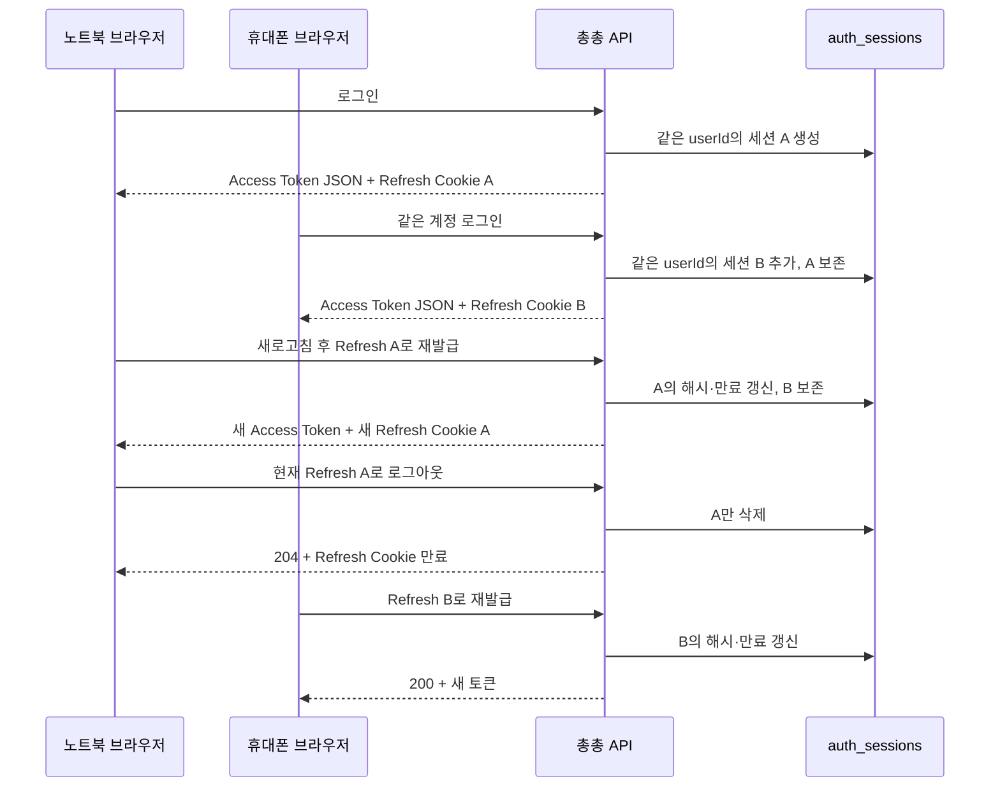

# 다중 인증 세션 사용·검증 안내

- 갱신일: 2026-10-18
- 작업: [#526](https://github.com/woowacourse-teams/2026-ChongChong/issues/526)
- 설계: [ADR 0051](adr/0051-allow-multiple-auth-sessions-per-user.md)
- 상태: 작업 브랜치 구현·자동 테스트 검증 완료, 실제 두 기기 확인 및 PR 리뷰·병합 대기

## 사용자와 브라우저별 동작

동일 사용자가 노트북과 휴대폰에서 로그인하면 각각 다른 Refresh Token과 `AuthSession`을 갖는다.
새 로그인은 기존 세션을 교체하지 않고 추가한다. Cookie 저장 공간을 공유하는 같은 브라우저 프로필의 탭은
별도 기기로 취급하지 않는다.



| 요청 | 서버 처리 | 다른 브라우저 세션 |
| --- | --- | --- |
| 로그인 | 새 세션 저장 | 유지 |
| 재발급 | 요청 Refresh Token의 세션만 회전 | 유지 |
| 로그아웃 | 요청 Refresh Token의 세션 삭제 | 유지 |
| 회원 탈퇴 성공 | 사용자 삭제와 DB CASCADE로 전체 세션 삭제 | 모두 재발급 불가 |

이미 발급된 Access JWT는 세션 삭제만으로 즉시 폐기되지 않는다. 프론트는 로그아웃·탈퇴 성공 후 메모리의
Access Token을 제거한다. 다른 브라우저에 남은 Refresh Token은 회원 탈퇴 후 재발급에 사용할 수 없다.

## 프론트엔드와 도메인 팀 사용법

- 기존 로그인·재발급·로그아웃 API의 요청·응답 필드와 Cookie·CSRF 계약을 사용한다.
- Access Token은 웹 메모리에 보관하고 도메인 요청에 `Authorization: Bearer ...`로 보낸다.
- 새로고침으로 Access Token이 사라져도 유효한 Refresh Cookie로 재발급할 수 있다.
- Refresh Token은 `HttpOnly` Cookie로 보관한다. 다중 로그인을 위해 `deviceId`나 Token 영구 저장 코드를 추가할 필요는 없다.
- 일반 로그아웃은 현재 세션에만 적용된다. 모든 기기 로그아웃 기능은 이번 범위에 없다.
- 백엔드 도메인은 기존처럼 `AuthenticatedUser.id()`를 사용한다. 세션 개수와 스터디별 권한은 별개다.
- 같은 브라우저 프로필의 탭은 Refresh Cookie를 공유한다. 현재 페이지 내 single-flight는 탭 사이의 재발급 경쟁까지 해결하지 않는다.
- 자세한 HTTP 계약은 [로그인](openapi/paths/auth/login.yaml), [재발급](openapi/paths/auth/refresh.yaml),
  [로그아웃](openapi/paths/auth/logout.yaml), [회원 탈퇴](openapi/paths/users/me.yaml)를 따른다.

## DB 변경과 배포

V21은 `auth_sessions.user_id`의 유일 제약을 제거하고 `idx_auth_sessions_user_id` 일반 인덱스를 생성한다.
기존 행·Refresh 해시·만료·감사 시각과 `refresh_token_hash` 유일 제약은 보존한다.

같은 사용자에게 여러 행이 저장된 뒤에는 이전 단건 조회 코드로 단순 복귀할 수 없다. 배포 시 마이그레이션과
다중 세션 코드의 호환성을 함께 확인한다. 기존 세션 전체 삭제나 운영 DB를 대상으로 한 수동 테스트는 필요하지 않다.

## 검증 결과와 재실행

- Auth 테스트: 순차·동시 로그인으로 독립 세션 생성, 세션별 회전과 이전 Token 거부, 개별 로그아웃을 확인했다.
- PostgreSQL 마이그레이션: V20 기존 세션 보존, V21 다중 저장, Refresh 해시 중복 거부와 일반 인덱스를 확인했다.
- PostgreSQL 탈퇴: 모든 세션 삭제, 해당 Token 재발급 거부와 다른 사용자 세션 보존을 확인했다.
- 두 PostgreSQL 테스트 모두 실행 결과 XML의 `skipped="0"`, 실패·오류 0을 확인했다.
- 전체 백엔드 테스트 통과는 2026-10-18 사용자 실행 결과로 확인했다.
- 아래 수동 시나리오는 아직 완료로 기록하지 않는다. 테스트 통과는 배포나 실제 두 기기 검증 완료를 의미하지 않는다.

Docker를 실행한 뒤 `backend`에서 실행한다.

```bash
./gradlew test --tests '*AuthSessionPostgresMigrationTest' --tests '*UserWithdrawalMultiSessionPostgresAcceptanceTest'
./gradlew test
```

Docker를 사용할 수 없으면 PostgreSQL 테스트는 건너뛸 수 있다. `BUILD SUCCESSFUL` 외에
`build/test-results/test/TEST-*.xml`의 `skipped`도 확인한다. H2의 Flyway 실행만으로 PostgreSQL의 제약·인덱스
동작을 보장하지 않는다. 이번에는 H2에서 사용자 유일 제약 제거 후에도 기존 인덱스가 남아 중복 저장이 거부되는
차이를 관찰하여, 다중 세션 탈퇴 검증을 PostgreSQL에서 실행했다.

수동 확인은 이 브랜치의 서버를 두 기기에서 접근할 수 있는 환경에서 수행한다. 최신 변경이 적용되지 않은 배포 서버는
검증 대상이 아니다. 휴대폰에서 노트북의 `localhost`에 그대로 접속할 수는 없으며 실제 접근 주소와 기존 Cookie·CORS
설정이 맞는 환경을 사용한다.

- [ ] 노트북에서 로그인한 뒤 휴대폰에서 같은 계정으로 로그인한다.
- [ ] 두 기기에서 각각 새로고침하고 보호 API가 성공하는지 확인한다.
- [ ] 노트북에서 로그아웃하고 휴대폰 새로고침·보호 API 접근이 성공하는지 확인한다.
- [ ] 테스트 계정으로 회원 탈퇴 후 다른 기기의 재발급이 실패하는지 확인한다.

## 별도 학습·고도화 기록

다음은 이번에 구현하지 않은 항목이다. 자동 테스트를 추가했다고 이 동작까지 지원하는 것으로 해석하지 않는다.
ID는 작업 폴더의 Auth 학습 백로그와 함께 사용한다.

| ID | 항목 | 현재 보장·미루는 이유 | 실패 실습과 제품 반영 Trigger |
| --- | --- | --- | --- |
| AUTH-L028 | 사용하지 않거나 만료된 세션 정리 | 만료 검증으로 재발급을 거부하지만 행을 자동 삭제하지 않는다. 브라우저 Cookie 삭제는 서버에 전달되지 않는다. 정리 주기·배치 정책은 후속으로 결정한다. | Cookie 삭제 후 재로그인하여 이전 행이 남는 것을 관찰하고 만료와 물리 삭제를 비교한다. 행 수·조회 비용 증가나 보관 정책 수립 시 제품 반영을 검토한다. |
| AUTH-L016 | 기기 관리·세션 상한·전체 로그아웃·키 교체 | 기본 다중 로그인은 구현했다. 로그인 기기명, 설치 식별자, 상한, 전체 로그아웃과 키 교체 중 이중 검증은 추가 요구가 필요하다. | 재로그인 누적, 분실 기기와 키 교체를 실습한다. 기기 관리나 보안 대응 정책이 확정되면 재검토한다. |
| AUTH-L015 | Token family·재사용 탐지·Access 즉시 폐기 | 현재 해시 회전과 만료 검증, 세션별 로그아웃을 제공한다. 과거 Token 이력을 추적하거나 JWT 폐기 목록을 조회하지 않는다. | 회전 전 Token 재사용과 로그아웃 후 Access JWT 유효성을 비교한다. 즉시 폐기·탈취 대응 정책 확정 시 검토한다. |
| AUTH-L023 | 여러 탭의 재발급 조정 | 페이지 내부 single-flight가 있지만 탭들은 Cookie를 공유하며 실행 상태는 공유하지 않는다. 이번 요구는 독립 Cookie의 두 기기 로그인이다. | 같은 프로필 두 탭에서 재발급을 겹쳐 실행한다. 실제 탭 간 충돌이 관찰되면 BroadcastChannel·잠금 등의 대안을 비교한다. |
| AUTH-L014 | H2·PostgreSQL 차이와 테스트 건너뜀 | 제약 전환과 탈퇴는 실제 PostgreSQL 테스트로 확인했다. 모든 H2 동시성 테스트를 PostgreSQL로 옮긴 것은 아니다. | Docker 유무에 따른 skipped와 실제 실패를 구별하고 같은 SQL의 DB별 동작을 비교한다. 운영 DB 특화 쿼리·잠금 변경 시 검증 범위를 확장한다. |
| AUTH-L027 | Refresh·Logout 동시 요청의 최종성 | 순차 로그아웃과 멱등 응답은 검증했다. 해시 회전과 HTTP Cookie 응답 순서 경쟁은 별도다. | Refresh와 Logout 순서 및 응답 순서를 바꿔 재현한다. 동시 요청 중 로그아웃 확정이 제품 요구가 되면 검토한다. |
