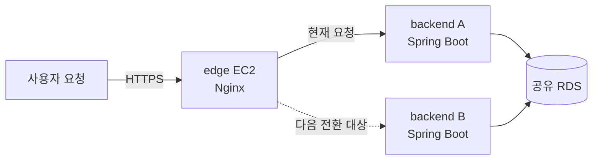
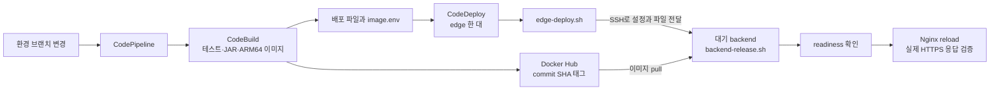

# 총총 백엔드 배포 안내

dev는 **요청을 받는 edge 1대와 앱을 실행하는 backend A/B 2대**로 구성한다.
새 버전을 대기 중인 백엔드에 띄우고 정상 응답을 확인한 뒤, edge가 요청을 보낼 대상을 바꾼다.
팀원이 서버에 접속할 때는 AWS Systems Manager의 Session Manager(SSM)를 사용한다.

이 문서는 현재 dev 구조를 기준으로 한다. prod의 A/B 전환은 별도 작업이며 완료된 것으로 가정하지 않는다.
저장소에는 기존 단일 서버 방식도 남아 있다. `buildspec.yml`은 `DEPLOYMENT_MODE=edge`일 때만
edge용 AppSpec을 선택하고, 값을 지정하지 않으면 `legacy`를 사용한다.

## 서버 세 대는 각각 무엇을 하나요?

아래 그림은 **A가 활성 서버인 예시**다. A와 B는 고정된 주 서버·보조 서버가 아니라, 배포할 때마다 역할을 바꾼다.



| 서버 | 실행하는 것 | 운영자가 알아야 할 점 |
| --- | --- | --- |
| edge | Nginx, 앱 메트릭 수집기(ADOT), CodeDeploy Agent | HTTPS와 인증서를 관리하고 A/B 배포·트래픽 전환을 수행한다. |
| backend A | Spring Boot 컨테이너 | 활성일 때 사용자 요청을 처리하고, 대기일 때 다음 배포 대상이 된다. |
| backend B | Spring Boot 컨테이너 | A와 같은 역할을 번갈아 맡는다. |

대기 서버도 앱이 실행 중이다. HTTP 요청이 가지 않더라도 DB 연결과 스케줄러·알림 작업은 남을 수 있다.
두 버전이 같은 DB를 사용하므로 스키마와 백그라운드 작업도 두 인스턴스가 함께 동작할 수 있어야 한다.

## 어떤 문서부터 읽으면 되나요?

| 하려는 일 | 문서 |
| --- | --- |
| 서버를 새로 준비하거나 빠진 설정을 찾기 | [서버 준비와 역할별 검사](server-setup.md) |
| 새 버전 배포, 앱 설정 변경, 실패 복구 | [A/B 배포 운영 절차](edge-deployment.md) |
| A/B 메트릭과 로그 확인, 부하 테스트 분석 | [모니터링 확인](monitoring.md) |
| 기존 단일 서버 환경을 관리하기 | [legacy 배포 참고](legacy-deployment.md) |
| Nginx 연결 한도를 정한 배경 확인 | [과거 실험 기록](nginx-limits-and-observability.md) |

처음 읽는 팀원은 이 문서에서 서버 역할을 확인하고, `edge-deployment.md`에서 배포 흐름과 복구 범위를 읽는다.
실제 설정값과 현재 활성 서버는 문서의 예시가 아니라 해당 환경의 edge에서 확인한다.

## 코드 변경이 서버에 도착하는 흐름



SSM은 사람이 접속하는 경로다. 배포 스크립트는 edge에서 A/B로 **배포 전용 SSH**를 사용한다.
CodeDeploy가 A/B에 직접 배포하는 구조가 아니므로 배포 그룹에는 해당 환경의 edge 한 대만 지정한다.

## 파일을 찾을 때

| 파일 | 역할 |
| --- | --- |
| `../buildspec.yml`, `../appspec.edge.yml` | 이미지와 배포 파일을 만들고 edge에서 배포를 시작한다. |
| `docker-compose.edge.yml` | edge의 Nginx·ADOT 컨테이너를 구성한다. |
| `docker-compose.backend.yml` | 각 백엔드의 앱 컨테이너를 구성한다. `docker-compose.yml`의 backend 정의를 상속한다. |
| `scripts/edge-deploy.sh`, `scripts/edge-runtime.sh` | 대기 서버 배포, 라우팅 검증·전환·실패 복구를 담당한다. |
| `scripts/backend-release.sh` | edge가 전달한 파일로 대상 백엔드의 앱만 교체한다. |
| `scripts/edge-rollback.sh` | 이전 백엔드로 라우팅을 되돌린다. |
| `scripts/check-server-setup.sh` | backend/edge 역할별 로컬 준비 상태를 읽기 전용으로 검사한다. |
| `scripts/setup-host-memory.sh`, `scripts/host-monitoring.sh` | 서버 준비 때 호스트 메모리 수집을 설치·설정한다. |
| `nginx/edge.conf.template`, `nginx/nginx.edge.conf`, `otel-collector.edge.yaml` | edge에 설치할 라우팅 템플릿·Nginx 한도·앱 수집 설정 원본이다. |
| `edge.env.example`, `.env.example` | edge 설정과 앱 설정을 준비할 때 참고한다. 실제 비밀값은 저장소에 넣지 않는다. |

`scripts/bootstrap-ec2.sh`, `prepare.sh`, `deploy.sh`, `validate.sh`, `runtime.sh`와
`docker-compose.dev.yml`은 legacy 실행 경로다. A/B 서버 준비나 edge 배포에 실행하지 않는다.
다만 `docker-compose.yml`은 A/B 백엔드도 상속하는 공통 정의이므로 오래된 파일이라고 삭제하면 안 된다.

## 변경한 뒤 확인할 것

```bash
python3 -m unittest discover -s deploy/tests -v
bash deploy/tests/host-monitoring-test.sh
for script in deploy/scripts/*.sh; do bash -n "$script" || exit 1; done
```

Docker가 실행 중인 환경에서는 `deploy/tests/nginx-smoke.sh`와 `deploy/tests/edge-nginx-smoke.sh`도 실행한다.
전체 CI 명령은 [deploy-ci.yml](../.github/workflows/deploy-ci.yml)에 있다. 로컬 테스트 통과는 실제 AWS 배포·지표
전송 성공을 뜻하지 않는다. 서버 적용 후에는 해당 운영 문서의 실제 응답·로그·메트릭 검증을 이어서 수행한다.
