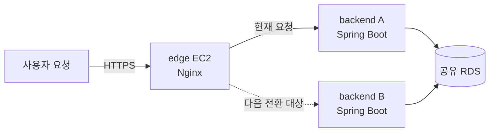
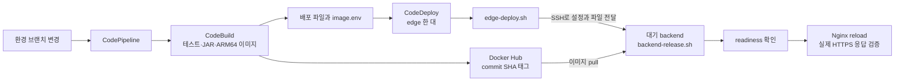

# 총총 백엔드 배포 안내

dev는 **요청을 받는 edge 1대와 앱을 실행하는 backend A/B 2대**로 구성한다.
새 버전을 대기 중인 백엔드에 띄우고 정상 응답을 확인한 뒤, edge가 요청을 보낼 대상을 바꾼다.
팀원이 서버에 접속할 때는 AWS Systems Manager의 Session Manager(SSM)를 사용한다.

> [!NOTE]
> 이 안내는 Ubuntu ARM64 EC2와 기존 VPC·RDS를 사용해 A/B 배포를 구성하는 절차다.
> EC2를 만든 다음 [서버 준비](docs/server-setup.md)부터 진행한다. VPC와 DB를 새로 만드는 과정은 포함하지 않는다.

## 처음 구성할 때 읽는 순서

| 순서 | 할 일 | 끝났을 때 확인할 결과 |
| --- | --- | --- |
| 1 | [서버 준비](docs/server-setup.md): AWS 설정 → SSM → Docker·메모리 수집 → SSH → 앱·Nginx | edge의 HTTPS 응답이 `UP`, 응답 헤더에 A 주소 표시 |
| 2 | [A/B 배포](docs/edge-deployment.md): 파이프라인 설정 → 첫 배포 → 전환 확인 | 배포 성공 후 응답 헤더가 B 주소로 변경 |
| 3 | [모니터링](docs/monitoring.md): 앱 지표 → EC2 메모리 → 로그 확인 | A/B 지표가 각각 보이고 최근 시각까지 갱신 |

각 명령 위에 실행 위치를 적었다. **AWS 콘솔**은 브라우저 화면, **edge·A·B 터미널**은 그 서버에 SSM으로 접속한 화면이다.

## 이 문서에서 쓰는 AWS 용어

| 용어 | 이 구성에서 하는 일 |
| --- | --- |
| EC2 / 인스턴스 | edge나 백엔드 프로그램을 실행하는 서버 |
| VPC / 서브넷 | 서버들이 연결된 네트워크와 그 안의 구역 |
| 보안 그룹 | 어느 서버가 어떤 포트로 접속할 수 있는지 정하는 규칙 |
| IAM 역할 | EC2나 빌드 도구가 S3·CloudWatch 등에 접근할 때 쓰는 권한 묶음 |
| SSM Session Manager | AWS 콘솔에서 서버 터미널을 여는 기능 |
| RDS | A/B가 함께 사용하는 데이터베이스 |
| CloudWatch | 서버 지표와 앱 로그를 확인하는 서비스 |
| CodeBuild / CodeDeploy / CodePipeline | 각각 이미지 빌드 / 서버 배포 / 전체 실행 순서를 담당 |

> [!IMPORTANT]
> A/B 배포의 CodeBuild 환경변수는 `DEPLOYMENT_MODE=edge`다. 생략하면 기존 단일 서버 배포인 `legacy`가 선택된다.

## 서버 세 대는 각각 무엇을 하나요?

아래 그림은 **A가 활성 서버인 예시**다. A와 B는 고정된 주 서버·보조 서버가 아니라, 배포할 때마다 역할을 바꾼다.



| 서버 | 실행하는 것 | 운영자가 알아야 할 점 |
| --- | --- | --- |
| edge | Nginx, 앱 메트릭 수집기(ADOT), CodeDeploy Agent | HTTPS와 인증서를 관리하고 A/B 배포·트래픽 전환을 수행한다. |
| backend A | Spring Boot 컨테이너 | 활성일 때 사용자 요청을 처리하고, 대기일 때 다음 배포 대상이 된다. |
| backend B | Spring Boot 컨테이너 | A와 같은 역할을 번갈아 맡는다. |

대기 서버도 앱이 실행 중이다. HTTP 요청이 가지 않더라도 DB 연결과 스케줄러·알림 작업은 남을 수 있다.
두 버전이 같은 DB를 사용하므로 스키마와 백그라운드 작업도 두 인스턴스가 함께 동작할 수 있어야 한다.

## 어떤 문서부터 읽으면 되나요?

| 하려는 일 | 문서 |
| --- | --- |
| 서버를 새로 준비하거나 빠진 설정을 찾기 | [서버 준비와 역할별 검사](docs/server-setup.md) |
| 새 버전 배포, 앱 설정 변경, 실패 복구 | [A/B 배포 운영 절차](docs/edge-deployment.md) |
| A/B 메트릭과 로그 확인, 부하 테스트 분석 | [모니터링 확인](docs/monitoring.md) |
| 기존 단일 서버 환경을 관리하기 | [legacy 배포 참고](docs/legacy-deployment.md) |
| Nginx 연결 한도를 정한 배경 확인 | [과거 실험 기록](docs/nginx-limits-and-observability.md) |

처음 구성할 때는 **서버 준비 → A/B 배포 → 모니터링 확인** 순서로 읽는다. 각 문서에 실행할 서버, 명령과 정상 결과를 적었다.

## 코드 변경이 서버에 도착하는 흐름



운영자는 SSM으로 접속한다. CodeDeploy는 edge에서 배포 스크립트를 실행하고, edge가 SSH로 대기 백엔드에 파일을 전달한다.

## 파일을 찾을 때

```text
deploy/
├── README.md       # 전체 구조와 읽는 순서
├── docs/           # 서버 준비·배포·복구·모니터링 문서
├── config/         # Compose, 환경변수 예시, 메트릭 수집 설정
│   ├── nginx/      # Nginx 설정과 템플릿
│   └── systemd/    # 인증서 갱신 service·timer
├── scripts/
│   ├── edge/       # edge의 A/B 배포·트래픽 전환·롤백
│   ├── backend/    # 대상 백엔드에서 앱 교체
│   ├── setup/      # 서버 준비 검사·메모리 수집·인증서 갱신
│   └── legacy/     # 기존 단일 서버 배포·초기 설치
└── tests/          # 배포 회귀 테스트와 Docker smoke test
```

아래 경로는 `deploy/` 기준이다. 빌드에서 생성하는 `image.env`는 기존처럼 `deploy/` 바로 아래에 둔다.
서버의 `config/backend.env`, `edge-runtime`, `edge-routing` 같은 운영 경로는 바뀌지 않는다.
Compose의 기본 프로젝트 이름은 `deploy`로 유지하며, A/B 앱은 스크립트에서 `chongchong-backend`를 지정한다.
legacy 복구는 폴더 정리 전후의 백업 구조를 모두 읽는다.

| 파일 | 역할 |
| --- | --- |
| `../buildspec.yml`, `../appspec.edge.yml` | 이미지와 배포 파일을 만들고 edge에서 배포를 시작한다. |
| `config/docker-compose.edge.yml` | edge의 Nginx·ADOT 컨테이너를 구성한다. |
| `config/docker-compose.backend.yml` | 각 백엔드의 앱 컨테이너를 구성한다. `config/docker-compose.yml`의 backend 정의를 상속한다. |
| `scripts/edge/edge-deploy.sh`, `scripts/edge/edge-runtime.sh` | 대기 서버 배포, 라우팅 검증·전환·실패 복구를 담당한다. |
| `scripts/backend/backend-release.sh` | edge가 전달한 파일로 대상 백엔드의 앱만 교체한다. |
| `scripts/edge/edge-rollback.sh` | 이전 백엔드로 라우팅을 되돌린다. |
| `scripts/setup/check-server-setup.sh` | backend/edge 역할별 로컬 준비 상태를 읽기 전용으로 검사한다. |
| `scripts/setup/setup-host-memory.sh`, `scripts/setup/host-monitoring.sh` | 서버 준비 때 호스트 메모리 수집을 설치·설정한다. |
| `config/nginx/edge.conf.template`, `config/nginx/nginx.edge.conf`, `config/otel-collector.edge.yaml` | edge에 설치할 라우팅 템플릿·Nginx 한도·앱 수집 설정 원본이다. |
| `config/edge.env.example`, `config/.env.example` | edge 주소·SSH 설정과 앱 환경변수의 예시다. |

`scripts/legacy/`와 `config/docker-compose.dev.yml`은 기존 단일 서버 배포에서 사용한다.
`config/docker-compose.yml`의 backend 정의는 A/B 배포에서도 공통으로 사용한다.

## 변경한 뒤 확인할 것

```bash
python3 -m unittest discover -s deploy/tests -v
bash deploy/tests/host-monitoring-test.sh
for script in deploy/scripts/*/*.sh; do bash -n "$script" || exit 1; done
```

Docker가 실행 중인 환경에서는 `deploy/tests/nginx-smoke.sh`와 `deploy/tests/edge-nginx-smoke.sh`도 실행한다.
전체 CI 명령은 [deploy-ci.yml](../.github/workflows/deploy-ci.yml)에 있다. 서버 적용 후에는 배포 문서의 health 확인과 모니터링 문서의 지표 조회를 실행한다.
