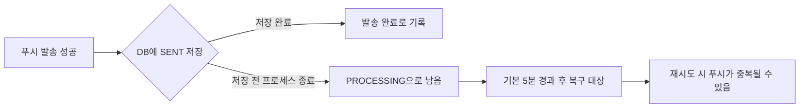

# 배포가 실패하거나 처리 중인 작업이 남으면 어떻게 되는가

prod에서 정상 배포와 롤백을 확인한 뒤, [#530](https://github.com/woowacourse-teams/2026-ChongChong/issues/530)의 실패 상황과 진행 중인 작업을 검사했다. 로컬 Nginx에서는 서버 전환 중 HTTP 150건과 4초짜리 요청이 모두 완료됐다. 실제 PostgreSQL에서는 두 워커 중 하나만 같은 발송 작업을 가져갔다.

검증은 2026-10-29 dev 기반 작업 브랜치에서 실행했다. 아래의 로컬 테스트와 [prod 측정 결과](prod-deployment-verification.md)는 환경과 확인한 범위가 다르다.

## 새 서버가 준비되지 않으면 요청을 보내지 않는가

새 서버가 준비되지 않았는데 요청 대상을 바꾸면, 정상적으로 동작하던 기존 서버가 있어도 사용자의 요청은 실패한다. 배포 스크립트가 이 상황에서 전환을 멈추는지 확인했다.

[배포 스크립트 테스트 30개](../evidence/remaining-checks-2026-10-29/deploy-tests.log)가 모두 통과했다. 준비 검사에 실패하면 배포가 실패로 끝나고, Nginx가 요청을 보낼 주소인 upstream은 기존 서버로 유지됐다. Nginx 설정을 다시 적용하는 reload도 실행하지 않았다.

SSH·curl·Docker 명령을 테스트용 명령으로 바꿔 실패를 만들고, 스크립트가 전환을 막는지 검사했다. AWS에서 실제 서버의 기동을 실패시키지는 않았다.

## 요청 대상을 바꾸는 도중 실패하면 이전 서버로 돌아가는가

설정 문법 검사, reload, 전환 후 응답 검증이 각각 실패하는 경우를 위 스크립트 테스트로 확인했다. 이전 upstream으로 돌아왔고, 복구 응답까지 확인하지 못하면 미완료 전환을 뜻하는 `pending` 파일을 남겨 다음 배포를 막았다.

잘못된 설정을 복원하는 동작은 [실제 Nginx에서도 확인했다](../evidence/remaining-checks-2026-10-29/nginx-http.log). 잘못된 upstream을 넣자 `nginx -t`가 거부했고 원본 파일이 복원됐다. 이어 Nginx를 재시작한 뒤에도 A의 정상 응답을 받았다. 전환 후 응답 검증 실패에 따른 자동 복구는 앞의 스크립트 테스트에서만 확인했다.

## 전환 전에 시작한 요청은 어디서 끝나는가

A가 4초 동안 처리하는 요청을 시작한 뒤 새 요청의 대상을 B로 바꿨다. 진행 중이던 요청은 A에서 끝났고, [응답 본문에도 A가 기록됐다](../evidence/remaining-checks-2026-10-29/slow-response.json). 함께 보낸 [연속 HTTP 150건](../evidence/remaining-checks-2026-10-29/http-result.txt)도 모두 성공했으며 A와 B의 응답을 모두 관측했다.

실제 Nginx와 테스트용 HTTP 서버로 실험했으며, Spring 앱의 긴 요청은 시험하지 않았다. 로그에는 전환 전 서버의 준비 상태를 확인하다 잠시 연결에 실패한 기록도 남았다. 이 요청은 150건 집계에서 제외했다.

현재 스크립트는 이전 앱을 즉시 종료하지 않는다. 이전 Nginx worker가 연결을 처리 중이면 다음 배포를 거절한다. 요청을 끝까지 처리할 수 있는 대신, 끝나지 않는 연결은 다음 배포를 지연시킬 수 있다. 연결을 강제로 끊는 별도의 제한 시간은 없다.

## 두 서버가 같은 알림을 동시에 처리하지 않는가

A/B 서버를 함께 실행하면 알림을 만드는 작업과 발송하는 작업도 양쪽에서 실행될 수 있다. 이 작업은 외부 HTTP 요청 없이 실행되므로 Nginx의 요청 대상을 바꿔도 중복 실행을 막지 못한다.

발송을 맡는 `DeliveryClaimService`는 DB 트랜잭션 안에서 처리할 작업을 가져오고 상태를 PROCESSING으로 바꾼다. 조회에 사용하는 `FOR UPDATE SKIP LOCKED`는 다른 트랜잭션이 잠근 작업을 기다리지 않고 건너뛴다.

새로 추가한 테스트에서는 첫 워커가 발송 작업을 가져온 뒤 트랜잭션을 열어 둔 채 두 번째 워커를 실행했다. 두 번째 워커는 같은 작업을 가져오지 않았다. 첫 트랜잭션이 커밋된 뒤에도 이미 PROCESSING인 작업을 다시 가져오지 않았고, 시도 횟수는 1로 유지됐다.

| 확인한 동작 | 테스트 |
| --- | --- |
| 두 워커 중 하나만 같은 공지 리마인더를 가져온다 | `ReminderClaimPostgresRepositoryTest.skipLockedNoticeReminderClaim` |
| 잠금 중과 커밋 후 모두 같은 발송 작업을 다시 가져오지 않는다 | `NotificationDeliveryPostgresRepositoryTest.concurrentWorkersClaimDeliveryOnlyOnce` |
| 앱 종료 시 진행 중인 발송 작업을 기다린 뒤 JPA·데이터소스를 종료한다 | `NotificationDeliveryExecutorConfigTest` |

앞의 두 테스트는 한 JVM에서 두 트랜잭션을 실행해 실제 PostgreSQL에 접근했다. 독립된 앱 두 개를 실행하거나 과제 리마인더를 동시에 가져오는 상황은 시험하지 않았다. 종료 테스트도 Spring 컨텍스트에서 실행했으며, 실제 푸시 발송이나 EC2 종료는 포함하지 않았다.

### 동시에 가져가지 않는 것과 한 번만 발송하는 것은 다르다

푸시를 보낸 직후 서버가 종료되면, 발송은 성공했어도 DB에는 완료를 남기지 못할 수 있다. 다음 흐름은 코드에서 확인한 재시도 가능성을 설명하며, 실제 강제 종료 실험 결과는 아니다.



외부 푸시 발송과 DB 저장은 하나의 트랜잭션이 아니다. `DeliveryRecoveryService`는 오래 남은 PROCESSING 작업을 재시도 대상으로 바꾼다. 이미 발송했더라도 DB에 완료를 기록하지 못했다면 다시 보낼 수 있다. 재시도 횟수를 모두 사용한 작업은 실패로 처리한다.

## 테스트 결과와 다시 실행하는 방법

백그라운드 관련 기존 테스트 28개가 실패·건너뜀 없이 통과했다([첫 실행 로그](../evidence/remaining-checks-2026-10-29/background-tests.log)). 발송 작업의 동시 선점 테스트를 추가한 뒤 관련 테스트 10개를 실행했고, 모두 통과했다([재실행 로그](../evidence/remaining-checks-2026-10-29/claim-concurrency-tests.log), [클래스별 개수](../evidence/remaining-checks-2026-10-29/claim-test-counts.txt)). 두 실행에는 같은 테스트가 포함되어 있다.

Docker를 실행한 뒤 저장소 루트에서 다음 명령을 사용한다.

```bash
python3 -m unittest discover -s deploy/tests -v
bash deploy/tests/edge-nginx-smoke.sh
cd backend
./gradlew test \
  --tests '*ReminderClaimPostgresRepositoryTest' \
  --tests '*NotificationDeliveryPostgresRepositoryTest' \
  --tests '*NotificationDeliveryWorkerTest' \
  --tests '*DeliveryRecoveryServiceTest' \
  --tests '*DeliveryResultServiceTest' \
  --tests '*NotificationResourceDeletionConcurrencyTest' \
  --tests '*NotificationDeliveryExecutorConfigTest'
```
