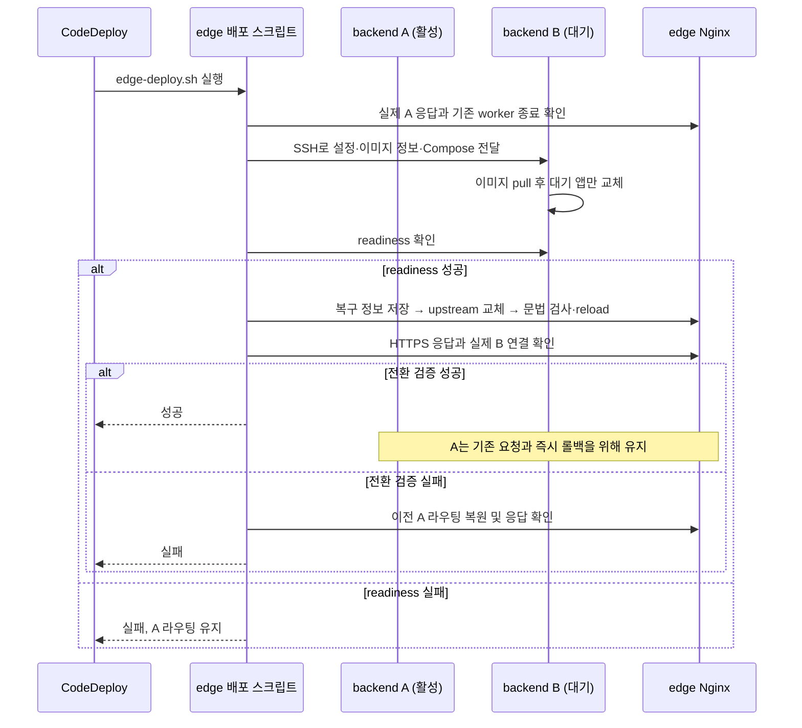

# A/B 배포와 복구 운영 절차

[전체 구조](../README.md)를 먼저 읽으면 edge와 A/B의 역할을 파악할 수 있다.
여기서는 서버 준비가 끝난 환경에서 앱을 배포하고 복구하는 과정을 설명한다.
최초 서버 구성과 단일 서버에서의 전환은 [서버 준비 절차](server-setup.md)를 따른다.

## 배포 전에 어디에 접속하나요?

사람은 SSM으로 **해당 환경의 edge**에 접속한다. CodeDeploy도 edge에서 시작한다.
A/B는 edge가 배포 전용 SSH로 제어하므로, 백엔드에서 `edge-deploy.sh`를 직접 실행하지 않는다.

운영 중인 환경에서는 아래 읽기 명령으로 설정과 현재 라우팅을 확인한다.

```bash
sudo grep -E '^(BACKEND_A_HOST|BACKEND_B_HOST|SERVER_NAME|CLOUD_WATCH_APP_ENV)=' \
  /opt/chongchong/config/edge.env
sudo cat /opt/chongchong/edge-routing/upstream.conf
```

A/B의 주소는 환경마다 다르며 현재 활성 대상도 배포마다 바뀐다.
파일에 A가 적혀 있다는 것만으로 실제 Nginx가 A에 연결한다고 확정하지 않는다.
[모니터링 문서](monitoring.md)의 HTTPS 확인으로 응답 헤더까지 대조한다.

## 설정 원본과 배포 사본은 어디에 있나요?

edge의 `config`가 설정 원본이다. 배포 스크립트는 원본과 이미지 정보를 한 시점의 사본으로 묶어
대상 백엔드에 전달한다. 배포 도중 원본이 바뀌어도 이미 만든 사본은 그대로 사용한다.

| 위치 | 파일·디렉터리 | 역할 |
| --- | --- | --- |
| edge | `/opt/chongchong/config/edge.env` | A/B 주소, SSH 키 경로, HTTPS 도메인, 환경을 지정한다. |
| edge | `/opt/chongchong/config/backend.env` | A/B가 공유하는 DB·인증·알림 등 앱 설정 원본이다. |
| edge | `/opt/chongchong/deploy/` | CodeDeploy가 전달한 스크립트·Compose·`image.env`가 있다. |
| edge | `/opt/chongchong/edge-runtime/` | 현재 Nginx·ADOT가 마운트하는 실행 설정이다. |
| edge | `/opt/chongchong/edge-routing/upstream.conf` | 요청을 보낼 백엔드 주소를 담는다. |
| edge | `/opt/chongchong/edge-state/` | 배포 잠금, 설정 사본, 이전 라우팅과 미완료 전환 정보를 보관한다. |
| A 또는 B | `/opt/chongchong/releases/release.*/` | 해당 배포의 앱 설정·이미지 정보·Compose를 함께 보관한다. |
| A 또는 B | `/opt/chongchong/current-backend-release` | 컨테이너 시작에 사용한 release를 가리킨다. readiness 성공 표시는 아니다. |

`config` 디렉터리는 root:700, 원본 두 파일은 root:600으로 관리한다.
설정은 Bash에서 읽으므로 셸 문법에 맞게 작성하고 비밀값을 Git에 넣지 않는다.
백엔드는 release 안의 `backend.env`를 읽는다. 기존 단일 서버의 `/opt/chongchong/.env`를 고쳐도
이 배포 방식의 앱 설정 원본은 바뀌지 않는다.

Nginx에는 `edge-routing` 디렉터리를 마운트한다. 전환 시 파일을 rename으로 교체하므로
파일 하나만 bind mount하면 새 파일을 읽지 못할 수 있다. 앱 비밀값이 있는 `edge-state`는 마운트하지 않는다.

## 정상 배포에서는 어떤 순서로 바뀌나요?

A가 활성이고 B가 대기 중인 예시다. 다음 배포에서는 A/B가 반대로 동작한다.



1. edge에서 배포 잠금을 잡는다. 미완료 전환 파일이 있거나 이전 Nginx worker가 기존 연결을 처리 중이면 중단한다.
2. 현재 upstream과 실제 HTTPS 응답이 같은 백엔드를 가리키는지 확인한다. 다르면 A/B를 변경하지 않는다.
3. 앱 설정·이미지·Compose를 사본으로 만들고 대기 서버에 전달한다. 대상은 Compose 검사와 이미지 pull을 먼저 끝낸다.
4. 대상 서버의 대기 앱만 graceful stop 후 교체한다. readiness는 최대 30회 확인한다.
5. 이전 upstream을 pending 파일에 남기고 새 upstream으로 교체한다. `nginx -t`를 통과하면 reload한다.
6. 실제 HTTPS 응답과 대상 주소를 최대 10회 확인한다. 성공하면 이전 라우팅을 롤백 대상으로 보관한다.

이전 활성 서버는 성공 직후 끄지 않는다. 기존 연결을 처리하고 직전 버전으로 돌아갈 수 있게 남긴다.
다음 배포에서 그 서버를 덮어쓰기 직전에 직전 롤백 대상을 무효화한다. 따라서 **다음 배포가 실패했다고
그 서버를 여전히 이전 버전이라고 보고 롤백할 수는 없다.**

## 앱 배포와 설정 변경

일상 배포는 환경별 CodePipeline을 사용한다. 수동 배포가 필요하면 자동 배포가 진행 중이지 않은지 먼저 확인하고
edge에서 다음을 실행한다. 이 명령은 새 이미지를 빌드하지 않고 현재 `deploy/image.env`의 이미지를 사용한다.

```bash
sudo bash /opt/chongchong/deploy/scripts/edge/edge-deploy.sh
```

앱 설정을 바꿀 때는 edge의 `config/backend.env`를 수정한 뒤 배포한다.
한 번 실행하면 대기 슬롯 하나에만 반영된다. 양쪽에 같은 설정을 반영하려면 첫 전환을 검증하고 기존 연결이
종료된 뒤 다시 배포한다. 원본 수정이나 컨테이너의 단순 restart만으로 새 환경변수가 전달되지는 않는다.

앱 배포는 Nginx·ADOT 컨테이너를 재생성하지 않는다. `deploy/config/nginx`나 `config/otel-collector.edge.yaml`을
수정해 커밋해도 이미 설치된 `edge-runtime`은 자동으로 바뀌지 않는다.
해당 설정 변경은 백업·검증·적용 시간을 정한 별도 edge 운영 작업으로 수행한다.

## 실패했을 때 어디까지 복구하나요?

| 실패한 단계 | 유지되는 것 | 다음 확인 |
| --- | --- | --- |
| 설정 전달·이미지 pull·readiness | 기존 활성 서버로 가는 라우팅 | 대상 백엔드 로그와 CodeDeploy 로그 |
| Nginx 설정 검사·reload | 이전 upstream 파일 복원을 시도 | 실제 응답이 이전 대상으로 돌아왔는지 |
| 전환 후 HTTPS 검증 | 이전 라우팅 복구와 응답 검증을 시도 | 복구 실패 시 pending 상태와 Nginx |
| 프로세스 강제 종료·edge 장애 | 자동 복구를 보장하지 않음 | pending 파일이 있으면 새 배포보다 복구 우선 |

직전 백엔드가 살아 있고 롤백 대상 기록이 남아 있을 때 edge에서 실행한다.

```bash
sudo bash /opt/chongchong/deploy/scripts/edge/edge-rollback.sh
```

이 명령은 이전 백엔드의 readiness를 확인하고 **라우팅만** 되돌린다.
이미지를 다시 pull하거나 설정 원본을 읽어 앱을 재생성하지 않는다.
pending 파일이 있으면 일반 이전 기록보다 우선 사용한다. 복구 응답 검증에 실패하면 pending을 남기므로
원인을 해결하기 전까지 새 배포가 차단된다. pending 파일만 지워서 배포를 재개하지 않는다.

CodeDeploy 자동 롤백은 이전 artifact로 다시 배포하는 별도 동작이다. 현재 설정 원본을 다시 읽기 때문에
과거 앱 설정까지 복원하는 기능이 아니다. 환경의 자동 롤백 정책과 수동 라우팅 복구를 구분해 운영한다.

## AWS 파이프라인을 연결할 때

- CodeBuild는 `buildspec.yml`로 테스트·JAR·ARM64 이미지를 만들고 commit SHA 태그를 push한다.
  `DEPLOYMENT_MODE=edge`를 지정해야 `appspec.edge.yml`을 artifact의 `appspec.yml`로 선택한다.
- CodeDeploy 그룹은 환경별 edge 한 대만 선택한다. A/B를 같은 AllAtOnce 그룹에 넣지 않는다.
- 환경별 CodePipeline은 QUEUED 실행을 사용한다. edge의 flock은 스크립트 동시 실행을 막지만,
  CodeDeploy의 artifact 파일 복사 단계까지 잠그지 않는다.
- 이 AppSpec은 ApplicationStart 하나에서 배포·전환·검증·실패 복구를 끝낸다.
  legacy의 BeforeInstall·ValidateService와 이미지 prune은 실행하지 않는다.
- Docker Hub 태그는 commit SHA이지만 레지스트리 수준의 불변 태그를 보장하는 것은 아니다.

## 남겨두는 자료와 운영 제약

edge의 `deployment.*` 사본은 기본 3개를 보관한다. `EDGE_DEPLOYMENT_RETENTION_COUNT`로 조정할 수 있고,
마지막 성공 사본은 개수에 포함해 보존한다. pending 상태에서는 복구 자료를 지우지 않는다.
백엔드의 실패 후보 release는 정리하지만 현재 release는 보존한다. 성공한 이전 release와 rollback 작업
디렉터리는 자동 정리 대상이 아니다. 비밀값이 포함되므로 root 전용 권한을 유지한다.

두 버전은 같은 DB를 사용한다. 파괴적 스키마 변경은 라우팅을 되돌려도 복구되지 않는다.
알림·스케줄러는 대기 서버에서도 실행될 수 있으므로 중복 처리 방지는 별도로 검증한다.
실제 무중단 여부는 연속 요청·긴 요청을 유지하며 배포와 롤백을 수행해 확인한다.
