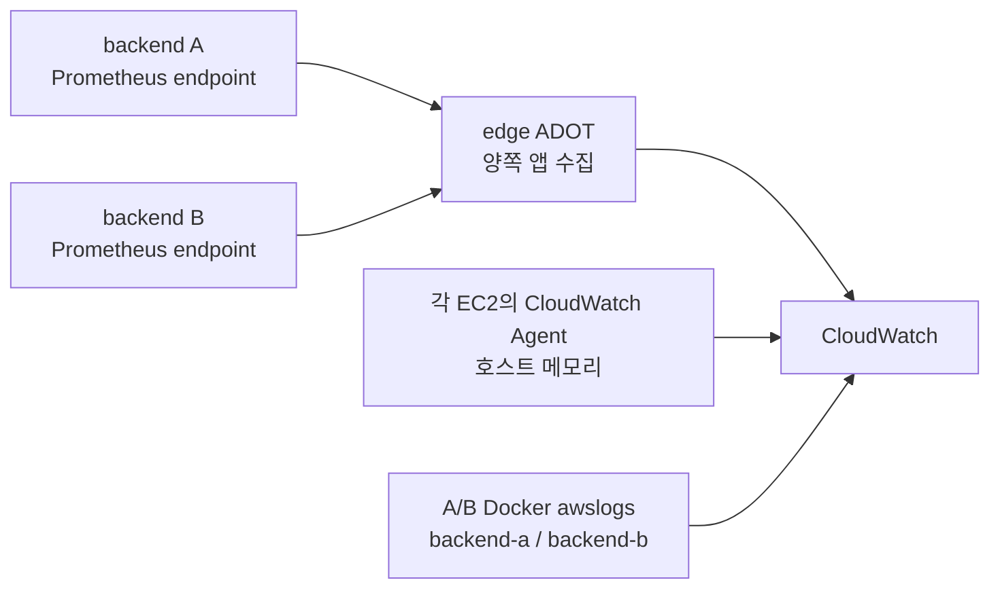

# A/B 배포 환경의 메트릭과 로그 확인

트래픽이 A에서 B로 바뀌어도 수집 대상을 바꾸지 않는다. edge의 ADOT 수집기는 양쪽 앱을 계속 조회한다.
호스트 메모리는 각 EC2의 CloudWatch Agent가 따로 보낸다. 따라서 JVM 메모리가 보여도 EC2 전체 메모리는
없을 수 있다. 두 지표는 수집 경로가 다르다.



## 무엇을 함께 보고 무엇을 나누어 보나요?

| 지표 | 보는 방법 | 이유 |
| --- | --- | --- |
| HTTP 요청량·오류율·p95 | 서비스 전체와 서버별 요청량 | 전환 중에도 전체 오류를 놓치지 않고 요청 이동을 확인한다. |
| JVM·앱 CPU·Hikari | A/B별 | 서로 다른 서버의 메모리 합계나 연결 최댓값을 한 서버 상태로 해석하지 않는다. |
| EC2 CPU·호스트 메모리 | InstanceId별 | 앱 서버와 edge의 자원 부족을 구분한다. |
| RDS | 공유 DB 전체 | 두 앱과 다른 DB 클라이언트가 만든 부하를 포함한다. |
| 알림 큐 | 각 서버가 관측한 값 | 같은 공유 큐의 관측값을 더해 중복 집계하지 않는다. |

CloudWatch의 앱 시계열은 `environment`, `service`로 환경과 서비스를 고른 뒤
`@resource.service.instance.id`로 서버를 구분한다. dev에서 확인한 값은 `IP:8080` 형태다.
일반 Prometheus의 `instance`라는 이름으로 조회 조건을 추정하지 말고 원본 결과의 라벨을 확인한다.

```promql
process_uptime_seconds{environment="dev",service="chongchong-backend"}
```

위 쿼리는 집계하지 않은 결과를 보여준다. 해당 환경의 A/B 주소가 각각 있는지, 최신 시각까지 값이
들어오는지 확인한다. 데이터가 없으면 0이나 정상 상태로 처리하지 않는다.

## edge에서 실제 라우팅과 수집기를 확인하기

다음 명령은 edge의 SSM 터미널에서 실행한다. 앱 비밀값이 있는 `backend.env` 전체는 출력하지 않는다.

```bash
sudo cat /opt/chongchong/edge-routing/upstream.conf
sudo grep -E '^(BACKEND_A_HOST|BACKEND_B_HOST|SERVER_NAME)=' /opt/chongchong/config/edge.env
sudo docker ps --filter name=chongchong-metrics-collector
sudo docker logs --since 10m chongchong-metrics-collector
```

실제 응답이 향하는 서버는 다음처럼 확인한다. 인증서 검증을 유지하고 edge 자신의 HTTPS 경로를 조회한다.

```bash
sudo bash -c '
  set -Eeuo pipefail
  source /opt/chongchong/config/edge.env
  curl --fail --silent --show-error --connect-timeout 2 --max-time 5 \
    --resolve "${SERVER_NAME}:443:127.0.0.1" \
    --dump-header - "https://${SERVER_NAME}/actuator/health"
'
```

본문의 `UP`, 응답의 `X-Deploy-Backend`, upstream 파일의 주소를 대조한다.
이 확인은 edge 내부에서 본 경로다. 사용자 쪽 DNS·외부 접속 확인은 별도로 수행한다.
현재 활성 서버·배포 시점을 대시보드에 자동 기록하는 기능은 없다. 요청량이 0이라는 이유만으로 대기 슬롯을 정하지 않는다.

## 설정을 바꾸려면 어느 파일을 수정하나요?

| 바꿀 내용 | 위치 | 반영 방법 |
| --- | --- | --- |
| 앱 지표 종류 | edge의 `edge-runtime/otel-collector.yaml` | 원본은 `otel-collector.edge.yaml`. 백업 후 수집기만 별도 재생성하고 전송을 확인한다. |
| 앱 수집 간격 | edge의 `config/edge.env` | `METRICS_SCRAPE_INTERVAL`·`METRICS_SCRAPE_TIMEOUT` 설정 후 수집기를 재생성한다. |
| 호스트 메모리 | 각 서버의 CloudWatch Agent | [서버 준비 절차](server-setup.md)의 설정 스크립트를 사용한다. |
| 앱 로그 환경 | edge의 `config/backend.env` | 앱 배포를 거쳐 A/B에 순차 반영한다. |

앱 수집 기본값은 60초·timeout 10초다. timeout은 수집 간격보다 길면 안 된다.
수집기를 재생성하면 누적 지표의 기준점이 초기화될 수 있다. 최소 두 수집 주기 이후 실제 전송을 확인한다.
로그가 비어 있거나 컨테이너가 실행 중이라는 사실만으로 CloudWatch 수신을 보장하지 않는다.

## 로그는 어디서 보나요?

백엔드 로그 그룹은 `/chongchong/<환경>/backend`이고 스트림은 `backend-a`, `backend-b`로 나뉜다.
각 백엔드의 SSM 터미널에서도 `sudo docker logs --since 10m chongchong-backend`로 확인할 수 있다.
edge의 Nginx와 ADOT는 현재 Compose 기준으로 로컬 json-file 로그를 사용한다.

```bash
sudo docker logs --since 10m chongchong-nginx
sudo docker logs --since 10m chongchong-metrics-collector
```

## 부하 테스트에서 읽는 순서

성능 기준을 측정할 때는 활성 서버를 확인하고 테스트 중 배포를 멈춘다. 부하는 서비스 주소로 보내고,
부하 도구의 처리량·오류·응답 시간과 활성 백엔드의 CPU·JVM·Hikari를 같은 시간대로 비교한다.
대기 서버의 스케줄러나 DB 연결은 계속 존재할 수 있으므로 공유 RDS도 함께 본다.

배포 전환을 검증할 때는 일정한 부하를 유지하며 배포하고, 전환 시각을 기록한다.
전체 오류·지연, A/B 요청 이동, 긴 요청 완료, 실패 시 복구를 확인한다.
60초 수집은 수초짜리 순간 부하를 놓칠 수 있다. 수집 간격 단축은 별도 dev 실험으로 적용하고,
수집기 자원과 비용을 확인한 뒤 원래 값으로 복원한다. 조회 간격만 줄여도 원본 수집 해상도가 높아지지는 않는다.
